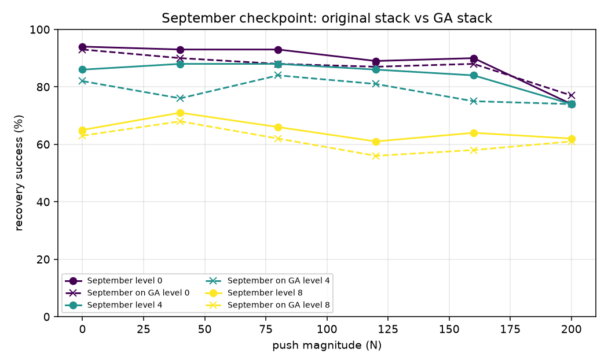
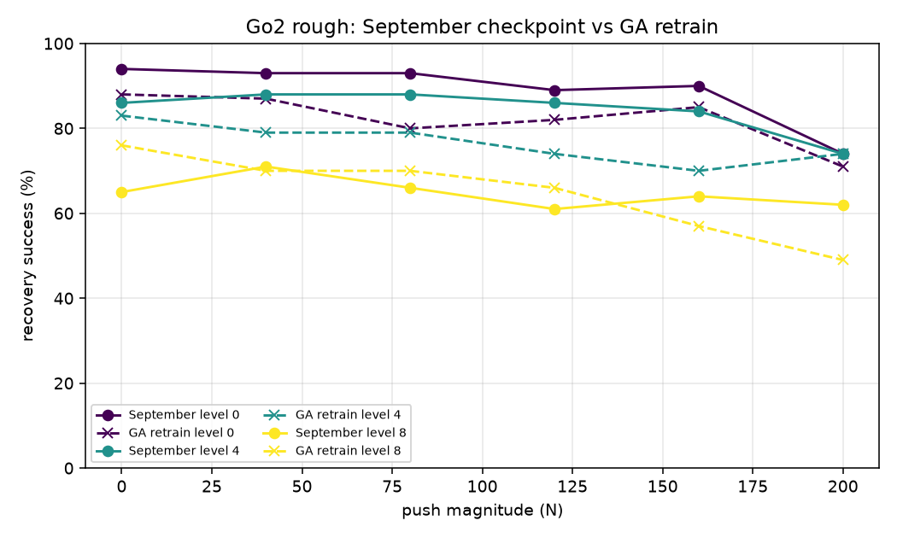

# Phase 0 parity: September checkpoint vs the Isaac Lab 3.0 GA stack

Measured 2026-11-07 on pod `rbbfy5mf5rd4az` (RTX 4090, driver 595.91.07). Three columns, one grid:
the September checkpoint re-evaluated on the old stack's numbers, the same checkpoint on GA, and the
GA retrain. 100 trials per cell, 1800 trials per column.

## What is being compared

| | September (source of truth) | September on GA | GA retrain |
|---|---|---|---|
| checkpoint | `go2_locomotion_v1_candidate.pt` (RUN_002) | the same file, same weights | `go2_locomotion_ga_v1_candidate.pt` |
| stack | Sim 5.x / Lab 2.3.2 / rsl-rl 3.1.2 | Sim 6.2 / Lab 3.0 GA (`e3f7d9ff`) / rsl-rl 5.5.1 | same GA stack |
| control path | legacy `ActorCritic` in-process | ONNX export, fed row by row | `MLPModel` in-process |
| physics | PhysX | **PhysX** (`PhysxCfg`, `use_newton_actuators=False`) | same |
| recipe | 1500 iters, 4096 envs, seed 42 | — | identical |

## Loading path: the September `.pt` cannot load on GA

```
CheckpointFormatError: Checkpoint '.../go2_locomotion_v1_candidate.pt' is in the LEGACY rsl-rl 3.x
format (single 'model_state_dict' key), but rsl-rl-lib 5.5.1 expects the SPLIT format
('actor_state_dict' + 'critic_state_dict', ...).
```

So the parity column runs the sibling `.onnx` export through onnxruntime. Two properties mattered: the
export has a **fixed batch of one** (`obs [1, 235]`), so the 1800-env sweep is fed row by row, and it
carries **no observation normaliser**, so raw observations go in. (The GA retrain's own export is also
fixed-batch; the same wrapper handles it.)

## Contract check: CONTRACT OK

Compared field by field against the September run's own dumped config, before any numbers:

| field | September | GA | status |
|---|---|---|---|
| observation terms | `base_lin_vel, base_ang_vel, projected_gravity, velocity_commands, joint_pos, joint_vel, actions, height_scan` | same, same order | ok |
| observation dim | 235 | 235 | ok |
| action dim / scale / offset | 12 / 0.25 / default-offset | same | ok |
| decimation, sim dt, step dt | 4 / 0.005 s / 0.02 s (50 Hz) | same | ok |
| command ranges | ±1.0 m/s x/y, ±1.0 rad/s yaw, heading ±π | same | ok |
| resample / standing envs | 10 s / 2% | same | ok |
| observation normaliser | none | none | ok |
| actor | 512-256-128, `ActorCritic` | 512-256-128, `MLPModel` (renamed in rsl-rl 5) | ok |

Two translations were needed before the check could speak: rsl-rl 5 reports unset fields as
`dataclasses.MISSING` rather than `null`, and it renamed the actor-critic class. A genuinely different
architecture (or an added normaliser) still fails.

Also recorded, and needed by the ROS node work: **`root_quat_w` is `xyzw`** on this stack, and a standing
Go2's `projected_gravity` reads `[-0.090, -0.129, -0.988]`.

## Side by side

| push | level | September | Sept on GA | GA retrain |
|---|---|---|---|---|
| 0 N | 0 | 94% | 93% | 88% |
| 0 N | 4 | 86% | 82% | 83% |
| 0 N | 8 | 65% | 63% | 76% |
| 40 N | 0 | 93% | 90% | 87% |
| 40 N | 4 | 88% | 76% | 79% |
| 40 N | 8 | 71% | 68% | 70% |
| 80 N | 0 | 93% | 88% | 80% |
| 80 N | 4 | 88% | 84% | 79% |
| 80 N | 8 | 66% | 62% | 70% |
| 120 N | 0 | 89% | 87% | 82% |
| 120 N | 4 | 86% | 81% | 74% |
| 120 N | 8 | 61% | 56% | 66% |
| 160 N | 0 | 90% | 88% | 85% |
| 160 N | 4 | 84% | 75% | 70% |
| 160 N | 8 | 64% | 58% | 57% |
| 200 N | 0 | 74% | 77% | 71% |
| 200 N | 4 | 74% | 74% | 74% |
| 200 N | 8 | 62% | 61% | 49% |
| **mean** | | **79.3%** | **75.7%** | **74.4%** |





## Verdicts

**September checkpoint on GA: PARITY BROKEN (marginal).** Mean −3.6 pp (inside the 5 pp mean
tolerance); one cell, 40 N / level 4, is −12 pp and outside the 10 pp per-cell rule. 17 of 18 cells are
inside. At 100 trials/cell the binomial SE is ~5 pp, so that cell is ~2σ: a small real degradation,
concentrated in one cell, not a broken transfer.

**GA retrain vs September: −4.9 pp on the mean**, inside the handoff's 10-point stop threshold. Five
cells move more than 10 pp, in both directions: 0 N / level 8 +11 pp (the GA policy is *better* on
untouched rough terrain) while 80 N / L0 (−13), 120 N / L4 (−12), 160 N / L4 (−14) and 200 N / L8 (−13)
are worse. The retrained policy is more terrain-capable at the top of the curriculum (terrain level
5.85 mean, 14.3% of envs at the maximum, vs 5.90 / 14.7% — the same) but slightly weaker under the
heaviest pushes.

Per the handoff, the GA checkpoint is the Phase 0.5 candidate regardless of the P1 verdict; it is
within 10 points of September, so the adversarial gate proceeds.

## Reproduce

```bash
$ISAACLAB_PATH/isaaclab.sh -p policy/locomotion/eval/push_recovery_eval.py \
    --platform go2 --terrain rough --headless \
    --checkpoint <ckpt.pt> [--policy_onnx <ckpt.onnx>] \
    --contract_reference policy/locomotion/runs/2026-09-08_19-28-32_analysis \
    --magnitudes 0,40,80,120,160,200 --terrain_levels 0,4,8 --trials_per_cell 100 \
    --output <report>/eval.csv

pixi run python policy/locomotion/eval/make_parity_report.py \
    --reference policy/locomotion/runs/2026-09-08_19-28-32_analysis/eval/eval_rough_full_sweep.csv \
    --candidate <report>/eval.csv --contract <report>/eval_contract.txt \
    --reference-label September --candidate-label "GA retrain" \
    --out-md <report>/parity.md --out-plot <report>/parity.png
```

Artifacts: `data/reports/ga_stack/` (September-on-GA), `data/reports/ga_retrain/` (GA retrain sweep,
sidecar, per-trial CSV, contract table, parity table and plot).
